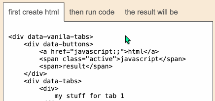

# Preview



# What is it?

It would be nice to have some easy to use tabs system for raw html which would work declaratively just after loading one js and one css file, without need for manual javascript to attach event.
Also that should also work for all dynamically created formation of html tags introduced to the page after initial library is loaded.

So this is that: one dependency free file of vanilla js (written in TypeScript, [event delegation](https://developer.mozilla.org/en-US/docs/Learn/JavaScript/Building_blocks/Event_bubbling#event_delegation),
keyboard support, aria attributes) + one css file. And the same tabs as a React component. Have fun.

It is not an npm package: you copy the files you need into your project.

# Demo & Docs

- vanilla: https://stopsopa.github.io/tabs/
- React: https://stopsopa.github.io/tabs/demo/react/

# Two ways to use it

|              | [Vanilla](#vanilla)                                          | [React](#react)                               |
| ------------ | ------------------------------------------------------------ | --------------------------------------------- |
| for          | raw html, server rendered pages, any framework without React | React 18+ applications (also SSR: Next.js...) |
| you write    | html markup with `data-*` attributes                         | `<Tabs>` / `<Tab>` components                 |
| installation | copy 2 files, or CDN                                         | copy 2 files (`Tabs.tsx` + css)               |
| stylesheet   | `vanilla-tabs.css`                                           | the same `vanilla-tabs.css`                   |

Both look exactly the same (one stylesheet). Demos: [vanilla](https://stopsopa.github.io/tabs/), [React](https://stopsopa.github.io/tabs/demo/react/).
Use one or the other for given page - don't enable the vanilla script on a page rendering the React component.

# Vanilla

## Installation

Pick one of three ways.

### A. Copy the files (no build step, no npm)

Download to your project:

- [`vanilla-tabs.css`](https://stopsopa.github.io/tabs/skills/vanilla-tabs/vanilla-tabs.css) - always
- [`vanilla-tabs.esm.js`](https://stopsopa.github.io/tabs/skills/vanilla-tabs/vanilla-tabs.esm.js) - ES module, preferred
- or [`vanilla-tabs.js`](https://stopsopa.github.io/tabs/skills/vanilla-tabs/vanilla-tabs.js) - classic script, for older setups

```html
<link rel="stylesheet" href="./vanilla-tabs.css" />
<script type="module">
  import vanillaTabs from "./vanilla-tabs.esm.js?vanilla-tabs-autoenable";
</script>
```

or with the classic script (put it at the end of `<body>`):

```html
<link rel="stylesheet" href="./vanilla-tabs.css" />
<script src="./vanilla-tabs.js?vanilla-tabs-autoenable"></script>
```

Don't load both `vanilla-tabs.js` and `vanilla-tabs.esm.js` on the same page.

The js files are generated from [`skills/vanilla-tabs/vanilla-tabs.ts`](skills/vanilla-tabs/vanilla-tabs.ts) and are not stored
in the repository, that's why the links above point to github pages.

### B. CDN (nothing to copy)

Latest version from github pages (it changes with every commit to this repository - prefer copying the files):

```html
<link rel="stylesheet" href="https://stopsopa.github.io/tabs/skills/vanilla-tabs/vanilla-tabs.css" />
<script src="https://stopsopa.github.io/tabs/skills/vanilla-tabs/vanilla-tabs.js?vanilla-tabs-autoenable"></script>
```

### C. Bundler (vite, webpack, rollup, esbuild, parcel...)

Copy the TypeScript source [`vanilla-tabs.ts`](skills/vanilla-tabs/vanilla-tabs.ts) (or the generated `vanilla-tabs.esm.js`) and the css,
import them and call `vanillaTabs.autoenable()` - step by step in [Vanilla library in a bundler](#vanilla-library-in-a-bundler-vanilla-tabsts).

## Usage

### 1. Markup

```html
<div data-vanilla-tabs>
  <div data-buttons>
    <span>first</span>
    <span class="active">second</span>
    <button type="button">third</button>
  </div>
  <div data-tabs>
    <div>content of first</div>
    <div>content of second</div>
    <div>content of third</div>
  </div>
</div>
```

- `[data-buttons]` and `[data-tabs]` have to be direct children of `[data-vanilla-tabs]`.
- Buttons are direct children of `[data-buttons]` (`<span>`, `<button type="button">`, `<a>`...), panels are direct `<div>` children of `[data-tabs]`.
  They are matched by position, so there has to be the same number of both (otherwise the element is skipped with a warning in the console).
- `class="active"` on a button picks the initially open tab. Without it the first one is open.
- Buttons can contain other elements (icons, `<b>`...).
- Roles, `aria-*` attributes, `tabindex` and missing `id`s of buttons and panels are added by the library - don't write them.
- Tabs can be nested: put another `[data-vanilla-tabs]` inside a panel.

That's all when autoenable is on: tabs present on the page work, and tabs added to the page later (ajax, templates,
any framework) work too, without any extra call.

### 2. Enabling

Autoenable = handle clicks + activate all tabs on the page + watch the page for tabs added later. Any of these turns it on:

| how                                                          | where it works                      |
| ------------------------------------------------------------ | ----------------------------------- |
| `?vanilla-tabs-autoenable` in the url of the script / import | classic script, native ES module    |
| `<body class="vanilla-tabs-autoenable">`                     | classic script, native ES module    |
| `vanillaTabs.autoenable()`                                   | everywhere, required with a bundler |

Or do it step by step, taking only what you need:

```js
const unbind = vanillaTabs.bind(); // handle clicks and keyboard (delegated listeners on document)

vanillaTabs.active(); // activate initial tab in every [data-vanilla-tabs] present on the page

vanillaTabs.watchMutationsEnable(); // do the above automatically for tabs added later
```

`vanillaTabs.active({ root: element })` limits the activation to one part of the page. `vanillaTabs.destroy()` removes
everything the library attached (listeners, observers); the markup stays as it is.

The classic script can be loaded anywhere, also in `<head>`.

### 3. Colors

Tabs are transparent by default. Background and lines color are css variables:

```html
<!-- all instances -->
<style>
  [data-vanilla-tabs] {
    --vanilla-tabs-background-color: white;
    --vanilla-tabs-lines-color: #565656;
  }
</style>

<!-- single instance via style -->
<div data-vanilla-tabs style="--vanilla-tabs-background-color: white">...</div>

<!-- single instance via attributes (applied by js) -->
<div data-vanilla-tabs data-background-color="white" data-lines-color="navy">...</div>
```

### 4. Events

Every time tab becomes visible (also the initial one) `vanilla-tabs:change` event is dispatched on the tab content element and it bubbles:

```js
// register before loading vanilla-tabs.js to catch initially active tabs too
document.addEventListener("vanilla-tabs:change", function (e) {
  // previousIndex: tab visible before, -1 for the initial one
  const { parent, button, tab, index, previousIndex } = e.detail;
});
```

Or bind to single `[data-vanilla-tabs]` element - listener lives on that element, so it is destroyed together with it when element is removed:

```js
const unbind = vanillaTabs.on(element, function ({ parent, button, tab, index, previousIndex }) {});
```

Before a change made by the user (click, keyboard) cancelable `vanilla-tabs:before-change` is dispatched the same way,
with the same detail (`index` is the tab the user wants to open). Changes made from code are not announced and can't be stopped:

```js
document.addEventListener("vanilla-tabs:before-change", function (e) {
  if (e.detail.parent.id === "editor" && hasUnsavedChanges()) {
    e.preventDefault(); // current tab stays
  }
});
```

### 5. Switching tabs from code

```js
const element = document.querySelector("[data-vanilla-tabs]");

vanillaTabs.activeByIndex(element, 2); // zero based

vanillaTabs.activeByButtonElement(element, buttonElement);
```

Both throw when the index is out of range / the button doesn't belong to the element.

### 6. More tabs than available width

Prev/next arrows show up automatically when buttons don't fit. If you add/remove buttons manually
and you don't use watch mode, call `vanillaTabs.updateOverflow(element)` afterwards.

### 7. Keyboard and accessibility

Works out of the box, following the [WAI-ARIA tabs pattern](https://www.w3.org/WAI/ARIA/apg/patterns/tabs/):

| key                               | what                                                           |
| --------------------------------- | -------------------------------------------------------------- |
| <kbd>Tab</kbd>                    | enters the row on the active button, next press leaves the row |
| <kbd>←</kbd> <kbd>→</kbd>         | previous / next tab (wraps around), opens it and moves focus   |
| <kbd>Home</kbd> <kbd>End</kbd>    | first / last tab                                               |
| <kbd>Enter</kbd> <kbd>Space</kbd> | opens focused tab                                              |

The library sets `role="tablist"` / `tab` / `tabpanel`, `aria-selected`, `aria-controls`, `aria-labelledby` and a roving
`tabindex`. Keyboard focus is visible (`:focus-visible` outline in the color of the lines). The prev/next arrows are
not in the tab order - the row follows the focused tab on its own.

### 8. TypeScript

Types are in the source [`vanilla-tabs.ts`](skills/vanilla-tabs/vanilla-tabs.ts) (see [Vanilla library in a bundler](#vanilla-library-in-a-bundler-vanilla-tabsts)):

```ts
import vanillaTabs, { type VanillaTabs, type VanillaTabsChangeDetail } from "./tabs/vanilla-tabs";

document.addEventListener("vanilla-tabs:change", (e) => {
  const { parent, button, tab, index } = (e as CustomEvent<VanillaTabsChangeDetail>).detail;
});

const tool: VanillaTabs = window.vanillaTabs; // the same object, window.vanillaTabs is typed too
```

## Older versions (files in repo root)

Before the files moved to `skills/vanilla-tabs/` they were served from `https://stopsopa.github.io/tabs/vanilla-tabs.*`.
These tagged versions have no colors via variables/attributes, overflow arrows, events, keyboard support.

### v1.0.0

```html
<link rel="stylesheet" href="https://cdn.jsdelivr.net/gh/stopsopa/tabs@v1.0.0/vanilla-tabs.css" />
<script src="https://cdn.jsdelivr.net/gh/stopsopa/tabs@v1.0.0/vanilla-tabs.js"></script>
```

### v1.0.1

```html
<link rel="stylesheet" href="https://cdn.jsdelivr.net/gh/stopsopa/tabs@v1.0.1/vanilla-tabs.css" />
<script src="https://cdn.jsdelivr.net/gh/stopsopa/tabs@v1.0.1/vanilla-tabs.js?vanilla-tabs-autoenable"></script>
```

# React

Typed React component: [`skills/vanilla-tabs/Tabs.tsx`](skills/vanilla-tabs/Tabs.tsx). Demo with sources: https://stopsopa.github.io/tabs/demo/react/

It is implemented in React itself (it doesn't run the vanilla script): state lives in React, it renders the same markup
as the vanilla version and uses the same stylesheet. Safe for SSR. It is not meant to be installed - you **copy two files**
into your project and they become your code.

## Minimal instructions

1. Copy two files from [`skills/vanilla-tabs/`](skills/vanilla-tabs) to your project, next to each other (for example to `src/tabs/`):
   - [`Tabs.tsx`](skills/vanilla-tabs/Tabs.tsx)
   - [`vanilla-tabs.css`](skills/vanilla-tabs/vanilla-tabs.css)
2. Use:

```tsx
import { Tabs, Tab } from "./tabs/Tabs";
import "./tabs/vanilla-tabs.css";

export default function Example() {
  return (
    <Tabs>
      <Tab label="first">content of first</Tab>
      <Tab label="second">content of second</Tab>
    </Tabs>
  );
}
```

That's all: no provider, no initialisation, no other files. Requires React 18+ and a bundler which handles `.tsx` and css imports.

## Complete instructions

### 1. What to copy

All files are in [`skills/vanilla-tabs/`](skills/vanilla-tabs):

| file               | needed                          | what it is                                                                                                 |
| ------------------ | ------------------------------- | ---------------------------------------------------------------------------------------------------------- |
| `Tabs.tsx`         | always                          | the component (`Tabs`, `Tab` + types). Imports only `react`                                                |
| `vanilla-tabs.css` | always                          | all styles. The same file the vanilla version uses                                                         |
| `vanilla-tabs.ts`  | **not** needed by the component | the vanilla library - only for tabs in raw html, see [below](#vanilla-library-in-a-bundler-vanilla-tabsts) |

From the terminal (run in the root of your project):

```bash
mkdir -p src/tabs && cd src/tabs
curl -fsSLO https://stopsopa.github.io/tabs/skills/vanilla-tabs/Tabs.tsx
curl -fsSLO https://stopsopa.github.io/tabs/skills/vanilla-tabs/vanilla-tabs.css
```

To update later: run the same commands again and look at the diff in git.

### 2. Requirements

- React 18 or newer (the component uses `useId`).
- TypeScript 4.5 or newer with the automatic JSX runtime: `"jsx": "react-jsx"` in `tsconfig.json` (default in Vite, Next.js, CRA
  templates). With the old `"jsx": "react"` add `import React from "react";` at the top of the copied `Tabs.tsx`.
- No TypeScript in the project? Generate plain js once and copy that instead:
  `npx esbuild Tabs.tsx --jsx=automatic --format=esm --outfile=Tabs.jsx`

### 3. Import in your bundler

The component is one import, the same everywhere:

```tsx
import { Tabs, Tab } from "./tabs/Tabs";
```

The stylesheet has to be loaded once per application. Where to put `import "./tabs/vanilla-tabs.css"`:

| bundler / framework              | where                                                                                                       |
| -------------------------------- | ----------------------------------------------------------------------------------------------------------- |
| Vite, Parcel, Rsbuild            | entry file (`src/main.tsx`) or next to the component using tabs. Works out of the box                       |
| webpack                          | the same, needs `css-loader` + `style-loader` (or `mini-css-extract-plugin`) for `.css` - usually there     |
| Next.js (app router)             | `app/layout.tsx`. The file using `<Tabs>` needs `"use client";` in its first line                           |
| Next.js (pages router)           | `pages/_app.tsx` (global css is allowed only there)                                                         |
| Remix / React Router (framework) | `import "./tabs/vanilla-tabs.css"` in `app/root.tsx`                                                        |
| esbuild                          | import it anywhere: esbuild writes `<outfile>.css` next to the js bundle - link that file in your html      |
| no css support at all            | put `vanilla-tabs.css` in the public directory and add `<link rel="stylesheet" href="/vanilla-tabs.css" />` |

Don't run the vanilla script (`vanilla-tabs.js`, `vanillaTabs.autoenable()`, `vanillaTabs.bind()`) on pages rendering `<Tabs>`:
its click handler would switch classes of the same elements behind React's back.

### 4. Usage

#### Uncontrolled - the component keeps the active tab

```tsx
<Tabs defaultIndex={1} onChange={(index) => console.log("user picked:", index)}>
  <Tab label="first">content of first</Tab>
  <Tab label="second">content of second</Tab>
  <Tab label={<b>third</b>}>content of third</Tab>
</Tabs>
```

#### Controlled - you keep the active tab

State, url, store... The tab changes only when the `index` prop changes:

```tsx
import { useState } from "react";
import { Tabs, Tab } from "./tabs/Tabs";

export default function Example() {
  const [index, setIndex] = useState(0);

  return (
    <>
      <button onClick={() => setIndex(2)}>go to third</button>
      <Tabs index={index} onChange={setIndex}>
        <Tab label="first">content of first</Tab>
        <Tab label="second">content of second</Tab>
        <Tab label="third">content of third</Tab>
      </Tabs>
    </>
  );
}
```

`onChange` is only a request: to refuse the change (unsaved form...) just don't call `setIndex`.

#### Events - run javascript when the tab changes

|                   | called when                                                     | called for the initial tab | use it for                                       |
| ----------------- | --------------------------------------------------------------- | -------------------------- | ------------------------------------------------ |
| `<Tabs onChange>` | user picked another tab (click, keyboard)                       | no                         | updating your state (controlled mode), analytics |
| `<Tabs onShow>`   | any tab became visible - by the user **or** by the `index` prop | yes                        | imperative code which needs a visible element    |
| `<Tab onShow>`    | the same, for that one tab                                      | yes, if it is that tab     | the same, without `if (index === ...)`           |

`onShow` runs after the panel is displayed, so its content has dimensions (charts, maps, editors, focus, measuring).
Its argument is `{ parent, button, tab, index, previousIndex }` - DOM elements of the root, of the button and of the panel,
zero based index, and the index of the tab visible before (`-1` for the initial one):

```tsx
import { Tabs, Tab, type TabsShowDetail } from "./tabs/Tabs";

function Example() {
  function redraw({ tab }: TabsShowDetail) {
    drawChart(tab.querySelector("canvas")!, tab.clientWidth);
  }

  return (
    <Tabs onShow={({ index }) => console.log("visible tab:", index)}>
      <Tab label="first">content of first</Tab>
      <Tab label="chart" onShow={redraw}>
        <canvas />
      </Tab>
    </Tabs>
  );
}
```

Together with `onShow` the component dispatches the same bubbling DOM event as the vanilla version
(`vanilla-tabs:change`, `event.detail` = argument of `onShow`), so one `document.addEventListener` can serve
tabs of both kinds (analytics...).

#### Lazy tabs - render the content when the tab is opened for the first time

```tsx
<Tabs>
  <Tab label="first">rendered from the beginning</Tab>
  <Tab label="report" lazy>
    <Report /> {/* mounted (its effects run, its data is fetched) on the first visit, then it stays mounted */}
  </Tab>
  <Tab label="video" unmountOnHide>
    <Player /> {/* mounted only while the tab is visible, its state is lost when another tab is opened */}
  </Tab>
</Tabs>
```

Without these props all panels are mounted all the time, inactive ones are hidden with css - state of components inside
inactive tabs is preserved.

#### Keyboard and accessibility

The same as in the vanilla version: roles and `aria-*` attributes, only the active button is in the tab order,
<kbd>←</kbd> <kbd>→</kbd> <kbd>Home</kbd> <kbd>End</kbd> open another tab and move focus, <kbd>Enter</kbd> / <kbd>Space</kbd>
open the focused one, keyboard focus is visible. Nothing to configure.

### 5. Props

`<Tabs>`:

| prop              | type                               | what                                                                      |
| ----------------- | ---------------------------------- | ------------------------------------------------------------------------- |
| `defaultIndex`    | `number`                           | initially active tab (uncontrolled mode), zero based, default `0`         |
| `index`           | `number`                           | active tab (controlled mode) - changes only when the prop changes         |
| `onChange`        | `(index: number) => void`          | user picked another tab (click, keyboard). Not called for the initial tab |
| `onShow`          | `(detail: TabsShowDetail) => void` | a tab became visible (also the initial one, also via `index`)             |
| `backgroundColor` | `string`                           | background of active button and panel, default transparent                |
| `linesColor`      | `string`                           | borders, text of the buttons, arrows, default `#565656`                   |
| anything else     |                                    | `className`, `style`, `id`, `data-*`, `ref`... go to the root `<div>`     |

`<Tab>`:

| prop            | type                               | what                                                             |
| --------------- | ---------------------------------- | ---------------------------------------------------------------- |
| `label`         | `ReactNode`                        | required. Content of the button, any node                        |
| `children`      | `ReactNode`                        | content of the panel                                             |
| `onShow`        | `(detail: TabsShowDetail) => void` | this tab became visible                                          |
| `lazy`          | `boolean`                          | don't render children until the tab is opened for the first time |
| `unmountOnHide` | `boolean`                          | render children only while the tab is visible                    |
| anything else   |                                    | `className`, `style`, `data-*`... go to the panel `<div>`        |

Types: `import { type TabsProps, type TabProps, type TabsShowDetail } from "./tabs/Tabs";`

Good to know:

- `<Tab>` elements have to be children of `<Tabs>` directly, in fragments, behind conditions (`{cond && <Tab ... />}`) or in lists -
  not wrapped in another component. Give list items a stable `key`: `{items.map((item) => <Tab key={item.id} label={item.name}>...</Tab>)}`
- `index` out of range falls to the closest existing tab.
- Tabs can be nested: render another `<Tabs>` inside a `<Tab>`.
- Prev/next arrows show up automatically when buttons don't fit.
- In `<StrictMode>` `onShow` is still called once per change.

### 6. Colors

```tsx
<Tabs backgroundColor="white" linesColor="navy">
  ...
</Tabs>
```

or for all instances in css, exactly like in the vanilla version:

```css
[data-vanilla-tabs] {
  --vanilla-tabs-background-color: white;
  --vanilla-tabs-lines-color: #565656;
}
```

### 7. SSR (Next.js and others)

The component renders on the server with the active tab already marked. It uses state and effects, so in frameworks
with React Server Components the file using it has to be a client component (or add `"use client";` as the first line
of the copied `Tabs.tsx` once, then it can be used from server components directly):

```tsx
"use client";

import { Tabs, Tab } from "./tabs/Tabs";
```

## Vanilla library in a bundler (`vanilla-tabs.ts`)

For tabs written as raw html markup (`data-vanilla-tabs`) in a project with a bundler - also in a React project, for html which
React doesn't render (CMS content, `dangerouslySetInnerHTML`, server templates). Not needed for `<Tabs>`.

1. Copy [`skills/vanilla-tabs/vanilla-tabs.ts`](skills/vanilla-tabs/vanilla-tabs.ts) and
   [`skills/vanilla-tabs/vanilla-tabs.css`](skills/vanilla-tabs/vanilla-tabs.css) to your project:

```bash
mkdir -p src/tabs && cd src/tabs
curl -fsSLO https://stopsopa.github.io/tabs/skills/vanilla-tabs/vanilla-tabs.ts
curl -fsSLO https://stopsopa.github.io/tabs/skills/vanilla-tabs/vanilla-tabs.css
```

Project without TypeScript: take `vanilla-tabs.esm.js` from the same url instead - the same code, already transpiled.

2. Import and enable once, in code which runs in the browser (entry file):

```ts
import vanillaTabs from "./tabs/vanilla-tabs"; // "./tabs/vanilla-tabs.ts" when your setup requires extensions
import "./tabs/vanilla-tabs.css";

vanillaTabs.autoenable(); // the ?vanilla-tabs-autoenable query string doesn't work through a bundler
```

It is a single file without imports; `tsconfig.json` needs `"lib"` with `"DOM"` and target ES2020 or newer (or a bundler
transpiling it down). Importing it on the server is safe, calling its methods is not - in SSR frameworks call `autoenable()`
in an effect: `useEffect(() => { vanillaTabs.autoenable(); }, []);`. Everything else is described in [Vanilla - Usage](#usage).

# Skill for AI agents

[skills/vanilla-tabs/SKILL.md](skills/vanilla-tabs/SKILL.md) is a standard agent skill explaining to AI how to use this library.
It covers both modes. The directory also contains everything the agent has to copy: `vanilla-tabs.css`, the React component `Tabs.tsx` and the
source `vanilla-tabs.ts` (the js files generated from it are downloaded from github pages when they are not next to the skill).

## Install the skill

Repository: https://github.com/stopsopa/tabs - the skill is the `skills/vanilla-tabs` directory.

Easiest, with the [skills CLI](https://github.com/vercel-labs/skills) (works for Claude Code and other agents):

```bash
npx skills add stopsopa/tabs
```

Manually for Claude Code (use `~/.claude/skills/` instead of `.claude/skills/` to install it for all projects):

```bash
git clone --depth 1 https://github.com/stopsopa/tabs.git /tmp/stopsopa-tabs
mkdir -p .claude/skills
cp -R /tmp/stopsopa-tabs/skills/vanilla-tabs .claude/skills/
rm -rf /tmp/stopsopa-tabs
```

For other agents copy the `skills/vanilla-tabs` directory to the place where that agent looks for skills.
After that ask the agent for tabs on your page or in your React application - it will copy the files it needs into your project.

# Dev notes

Everything what projects copy lives in `skills/vanilla-tabs/`:

- `vanilla-tabs.ts` - source of truth of the vanilla library. `npm run transpile` (or `xx transpile`) generates `vanilla-tabs.js` and
  `vanilla-tabs.esm.js` next to it with esbuild. They are in `.gitignore`: after cloning run `xx transpile` (`xx server` does it on its own),
  github actions generates them for github pages.
- `Tabs.tsx` - the React component. Its demo: `demo/react/` (`index.html` + `main.tsx` + one file per example in `examples/`;
  `transpile.sh` bundles it together with react to `demo/react/main.js`, generated, not in git).
- `vanilla-tabs.css` - styles of both.

| command (`xx <name>` or `npm run <name>`) | what                                                                                                                                              |
| ----------------------------------------- | ------------------------------------------------------------------------------------------------------------------------------------------------- |
| `transpile`                               | `vanilla-tabs.ts` -> `vanilla-tabs.js`, `vanilla-tabs.esm.js` next to it + `demo/react/main.js`                                                   |
| `server` (xx only)                        | transpile + demos on http://localhost:4286 (React: `/demo/react/`)                                                                                |
| `watch` (xx only)                         | the same, generated files are rebuilt on every change (`/bin/bash transpile.sh --watch`)                                                          |
| `typecheck`                               | `tsc` over sources, demo and tests                                                                                                                |
| `test`                                    | vitest + jsdom (`test/`): vanilla library, generated files, React component, examples of its demo, SSR                                            |
| `e2e`                                     | playwright (`e2e/`): mouse, keyboard and api on both demo pages in real chromium. First run: `npx playwright install chromium` (`xx e2e` does it) |
| `style:check` / `style:fix`               | prettier                                                                                                                                          |

There is nothing to release: a push to `master` runs all of the above in github actions and deploys github pages,
the place projects (and the skill) copy the files from.

Old urls `https://stopsopa.github.io/tabs/vanilla-tabs.{js,esm.js,css}` (before the files moved to `skills/vanilla-tabs/`)
are recreated during deployment by `.github/legacy_location.sh`; the js files print a console error asking to switch to the new url.

### License

The MIT License (MIT)
Copyright (c) 2015-2026 Szymon Działowski
Permission is hereby granted, free of charge, to any person obtaining a copy of this software and associated documentation files (the "Software"), to deal in the Software without restriction, including without limitation the rights to use, copy, modify, merge, publish, distribute, sublicense, and/or sell copies of the Software, and to permit persons to whom the Software is furnished to do so, subject to the following conditions:
The above copyright notice and this permission notice shall be included in all copies or substantial portions of the Software.
THE SOFTWARE IS PROVIDED "AS IS", WITHOUT WARRANTY OF ANY KIND, EXPRESS OR IMPLIED, INCLUDING BUT NOT LIMITED TO THE WARRANTIES OF MERCHANTABILITY, FITNESS FOR A PARTICULAR PURPOSE AND NONINFRINGEMENT. IN NO EVENT SHALL THE AUTHORS OR COPYRIGHT HOLDERS BE LIABLE FOR ANY CLAIM, DAMAGES OR OTHER LIABILITY, WHETHER IN AN ACTION OF CONTRACT, TORT OR OTHERWISE, ARISING FROM, OUT OF OR IN CONNECTION WITH THE SOFTWARE OR THE USE OR OTHER DEALINGS IN THE SOFTWARE.
